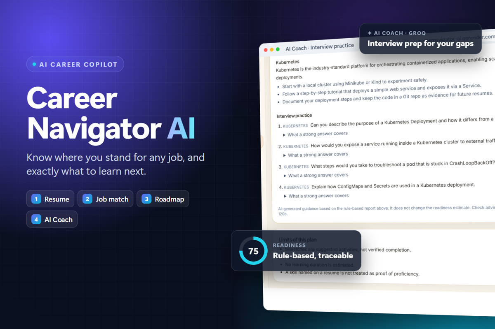
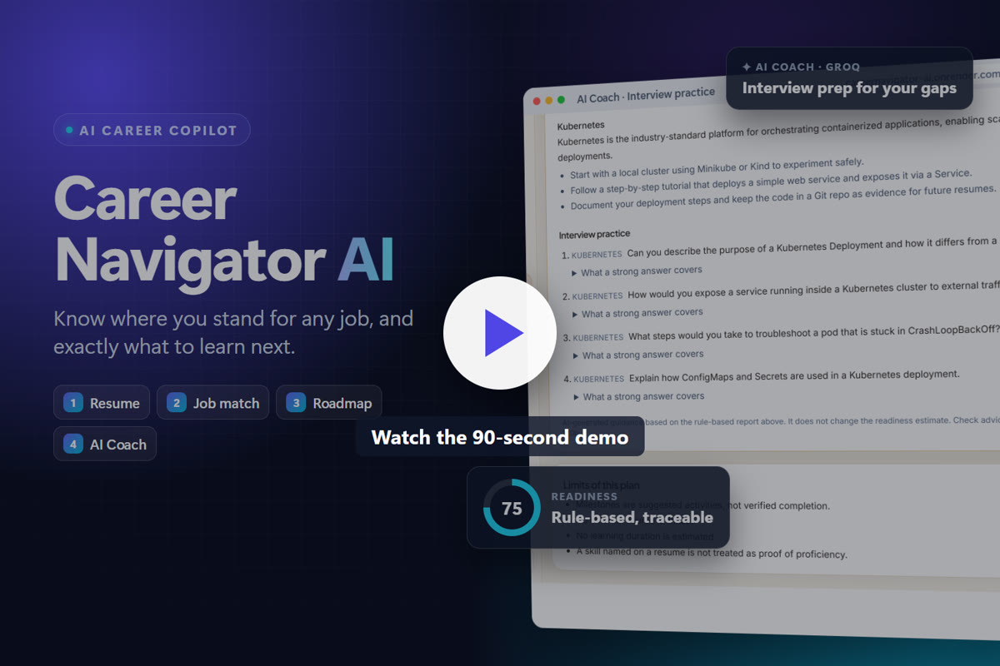
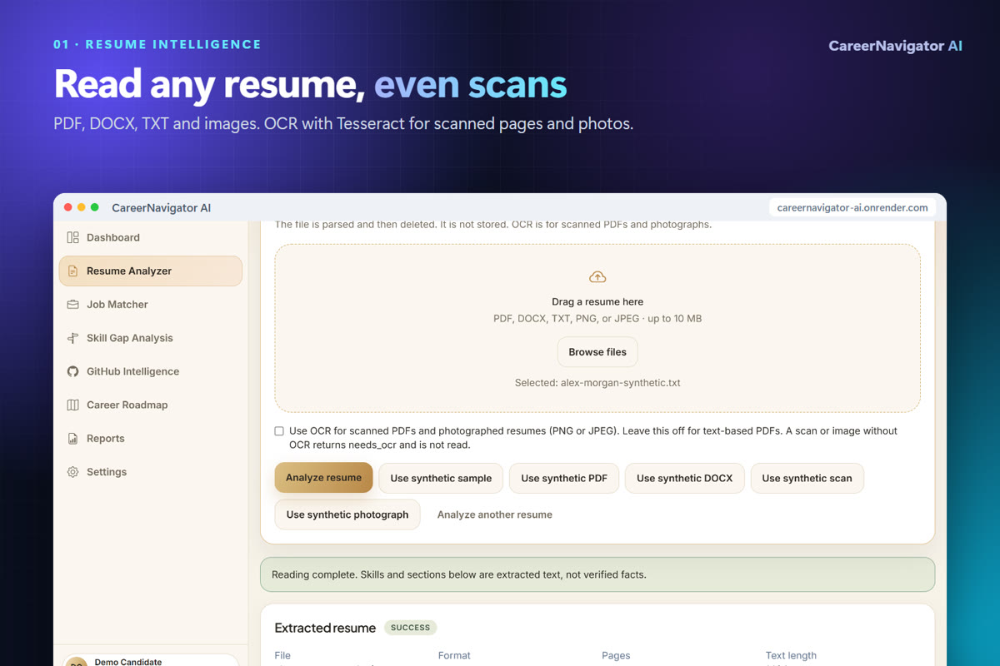
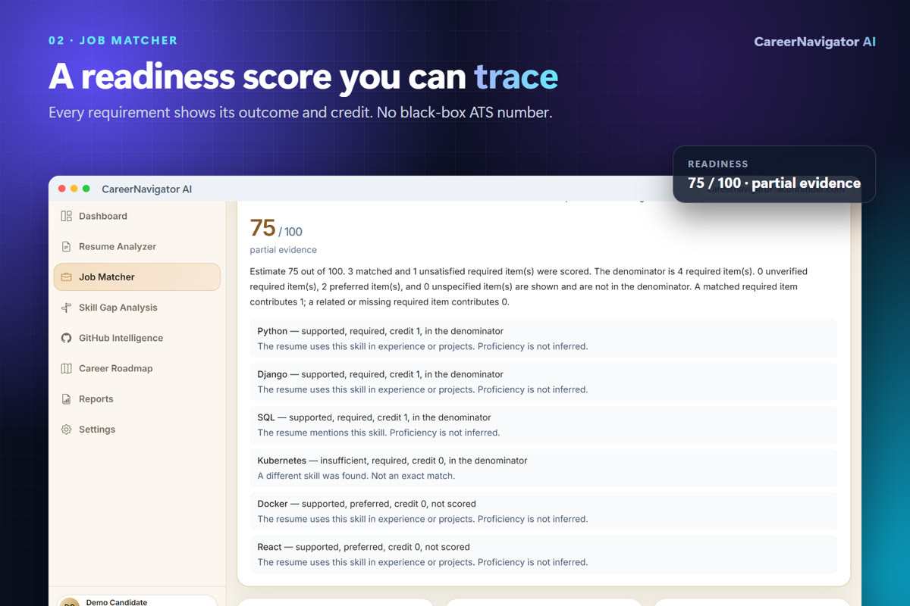
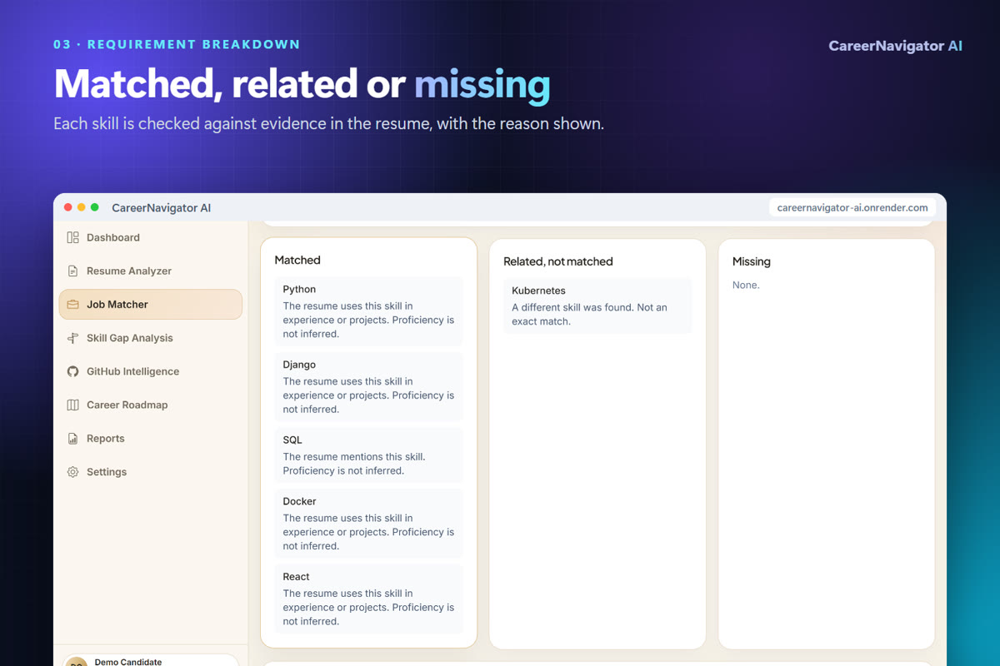
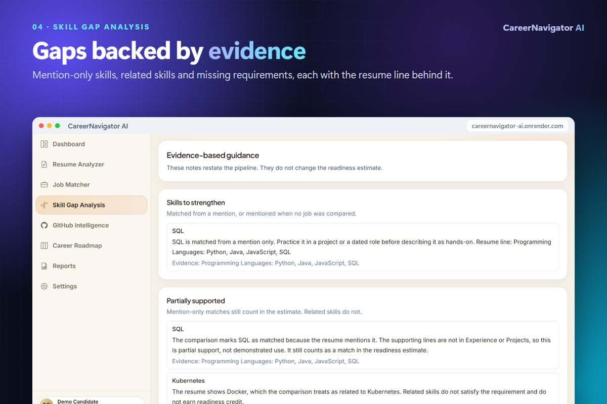
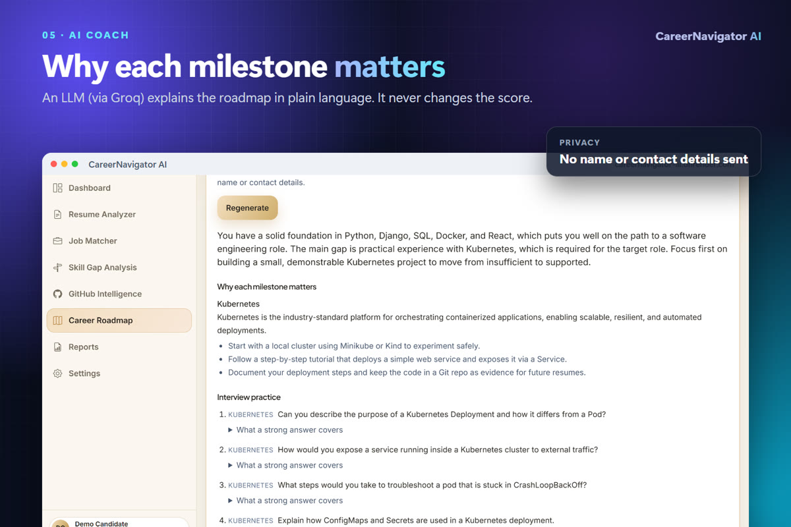
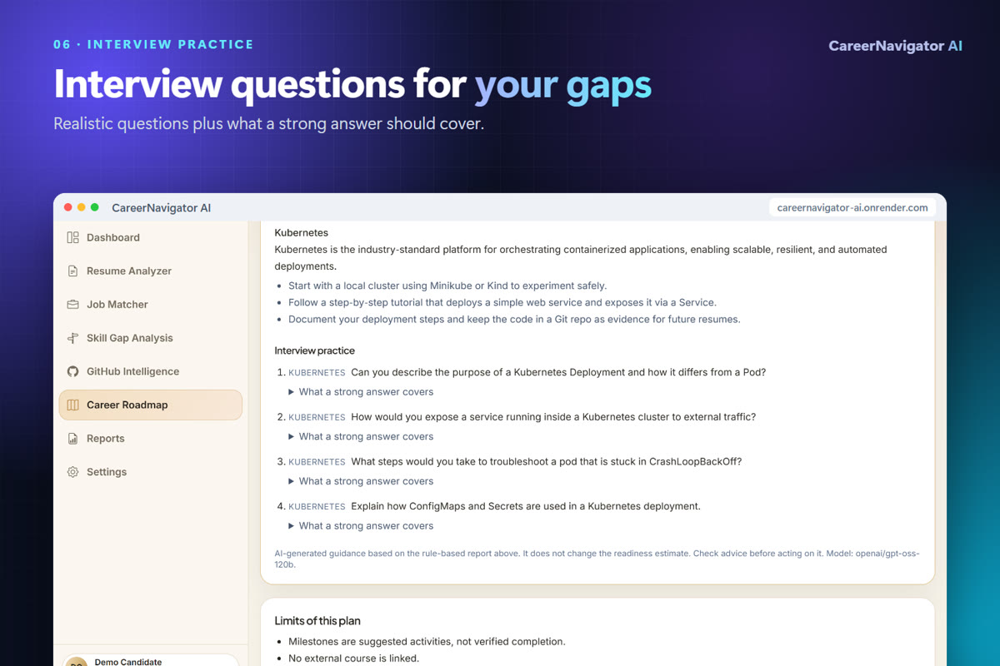

<p align="center">
  
</p>

<h1 align="center">CareerNavigator AI</h1>

<p align="center">
  <b>Know where you stand for any job, and exactly what to learn next.</b><br>
  Resume analysis, job matching, an explainable readiness score, a skill roadmap and an AI interview coach in one workspace.
</p>

<p align="center">
  <a href="https://careernavigator-ai.onrender.com"></a>
  <a href="https://youtu.be/PtzO6zJgQ0w"></a>
  
  
  
  
  
  
</p>

<p align="center">
  <a href="https://careernavigator-ai.onrender.com"><b>Try it live</b></a> ·
  <a href="https://youtu.be/PtzO6zJgQ0w"><b>Watch the demo</b></a> ·
  <a href="#installation"><b>Run locally</b></a> ·
  <a href="docs/ARCHITECTURE.md"><b>Architecture</b></a>
</p>

> **Important:** The core resume and job-matching pipeline is rule-based and explainable. It is not a trained hiring model, and its readiness estimate is not an ATS score or a prediction of employment.

---

## Demo

<p align="center">
  <a href="https://youtu.be/PtzO6zJgQ0w"></a>
</p>

The live app runs on Render's free tier, so the first load after a quiet period can take about a minute. Create an account, choose **Use synthetic sample** on the Resume Analyzer, then **Load synthetic posting** on the Job Matcher to see the full flow without a real resume.

## Screenshots

<table>
  <tr>
    <td width="50%"><br><sub><b>Resume Analyzer</b>: PDF, DOCX, TXT and images, with OCR for scans</sub></td>
    <td width="50%"><br><sub><b>Readiness estimate</b>: every requirement shows its credit</sub></td>
  </tr>
  <tr>
    <td><br><sub><b>Job Matcher</b>: matched, related or missing, with the reason</sub></td>
    <td><br><sub><b>Skill gaps</b>: each gap backed by a line from the resume</sub></td>
  </tr>
  <tr>
    <td><br><sub><b>AI Coach</b>: why each roadmap milestone matters</sub></td>
    <td><br><sub><b>Interview practice</b>: questions aimed at your skill gaps</sub></td>
  </tr>
</table>

---

## Table of Contents

- [Demo](#demo)
- [Screenshots](#screenshots)
- [Overview](#overview)
- [Key Features](#key-features)
- [How It Works](#how-it-works)
- [Technology Stack](#technology-stack)
- [Project Structure](#project-structure)
- [Requirements](#requirements)
- [Installation](#installation)
- [Running the Application](#running-the-application)
- [Optional Integrations](#optional-integrations)
- [Testing](#testing)
- [Security and Privacy](#security-and-privacy)
- [Current Limitations](#current-limitations)
- [Documentation](#documentation)
- [Contributing](#contributing)
- [License](#license)

---

## Overview

CareerNavigator AI turns a resume and a target job description into understandable career insights.

Instead of simply displaying a list of keywords, it helps users understand:

- Which required skills are already present in their resume.
- Which skills are missing or only partially supported.
- How their experience compares with a target role.
- Which areas deserve attention first.
- What practical learning milestones can help close skill gaps.

The platform also supports public GitHub profile analysis and optional AI-powered explanations through the AI Coach.

## Key Features

### 1. Resume Intelligence

Upload and analyze resumes in supported formats:

- PDF
- DOCX
- TXT
- PNG and JPEG images (OCR required)

The resume engine extracts available information, identifies skills, and distinguishes between skills demonstrated through usage and skills that are only mentioned.

### 2. Job Description Matching

Paste a job description and compare its requirements with extracted resume information.

The comparison identifies:

- Matched required skills.
- Missing required skills.
- Related skills.
- Preferred skills.
- Overall readiness estimate.

The estimate is based on the required-skill comparison rules. It is not an employment probability.

### 3. Skill Gap Analysis

Understand which skills need improvement based on the target job.

The system provides explanations for missing and partially supported requirements, helping users prioritize their learning.

### 4. GitHub Intelligence

Analyze a public GitHub profile to retrieve available repository and language information.

GitHub observations are presented separately from resume evidence. Repository language information alone is not proof of professional skill or proficiency.

### 5. Personalized Career Roadmap

Generate a structured roadmap from the resume and job comparison.

The roadmap includes:

- Recommended skill improvements.
- Practical project suggestions.
- Near-term and later milestones.
- Career direction guidance.
- Focus priorities based on the user's available weekly study hours.

### 6. Optional AI Coach

The AI Coach can provide additional explanations for roadmap milestones and generate interview questions related to identified skill gaps.

It requires an OpenAI-compatible chat-completions API configuration.

The AI Coach is optional. The core career-analysis pipeline works without it.

### 7. Reports

Generate downloadable career analysis reports in:

- Markdown
- JSON
- CSV

Reports use the existing analysis results rather than calculating a separate readiness score.

### 8. Modern Web Workspace

The React interface provides dedicated sections for:

- Dashboard
- Resume Analyzer
- Job Matcher
- Skill Gap Analysis
- GitHub Intelligence
- Career Roadmap
- Reports
- Settings

The workspace supports light and dark themes.

---

## How It Works

The application follows this general workflow:

1. The user uploads a resume.
2. The backend extracts available text and skills.
3. The user provides a target job description.
4. The engine compares extracted skills with job requirements.
5. The readiness assessment and skill gaps are generated.
6. Career guidance and roadmap recommendations are prepared.
7. The user can optionally analyze a public GitHub profile.
8. The user can generate and download a report.

### Readiness Assessment

The readiness estimate is calculated from required job skills.

- Matched required skills contribute credit.
- Missing and related required skills do not contribute credit.
- Preferred and unverified requirements are excluded from the denominator.
- If there are no scored required requirements, the estimate is unavailable.

The guidance layer explains the results but does not independently recalculate the readiness estimate.

---

## Technology Stack

| Component | Technology |
|---|---|
| Frontend | React, TypeScript, Vite |
| UI | Tailwind CSS, Lucide React |
| Backend | Python, FastAPI |
| Original interface | Streamlit |
| Resume processing | Python document-processing libraries |
| OCR | Tesseract |
| Data storage | SQLite |
| GitHub integration | GitHub REST API |
| Optional AI Coach | OpenAI-compatible chat-completions API |
| Testing | Pytest, Vitest |

---

## Project Structure

```text
CareerNavigator-AI/
│
├── frontend/
│   ├── src/
│   ├── public/
│   ├── package.json
│   └── vite.config.ts
│
├── research/
│   └── 01_resume_intelligence/
│       ├── api/
│       ├── assessment/
│       ├── parsing/
│       ├── web/
│       ├── tests/
│       ├── data/
│       └── requirements.txt
│
├── docs/
│   ├── ARCHITECTURE.md
│   ├── FEATURES.md
│   ├── TESTING.md
│   ├── SECURITY.md
│   ├── AUTHENTICATION.md
│   ├── TROUBLESHOOTING.md
│   ├── DEMO_SCRIPT.md
│   └── HACKATHON_SUBMISSION.md
│
├── .env.example
├── .gitignore
├── Dockerfile
├── render.yaml
├── PROJECT_AUDIT.md
└── README.md
```

---

## Requirements

Install the following before running the application:

- Python 3.10 or newer
- Node.js 22
- npm
- Git

**Optional:**

- Tesseract OCR for scanned PDF and image analysis.
- A GitHub token for a higher GitHub API rate limit.
- An OpenAI-compatible API key for the AI Coach.

---

## Installation

### 1. Clone the repository

```bash
git clone https://github.com/codewithsami1234/CareerNavigator-AI.git
```

Move into the project directory:

```bash
cd CareerNavigator-AI
```

### 2. Install backend dependencies

Open a terminal from the project root:

```bash
cd research/01_resume_intelligence
```

Install Python dependencies:

```bash
py -3 -m pip install -r requirements.txt
```

If your system uses `python` instead of `py -3`, use the appropriate Python command.

### 3. Install frontend dependencies

Open a second terminal from the project root:

```bash
cd frontend
```

Install packages:

```bash
npm install
```

---

## Running the Application

The development setup uses two terminals.

### Terminal 1 — Backend API

From the backend directory:

```bash
cd research/01_resume_intelligence
```

Start FastAPI:

```bash
py -3 -m uvicorn api.app:app --host 127.0.0.1 --port 8000
```

Backend API:

```text
http://127.0.0.1:8000
```

Interactive API documentation:

```text
http://127.0.0.1:8000/docs
```

### Terminal 2 — Frontend

From the project root:

```bash
cd frontend
```

Start Vite:

```bash
npm run dev
```

Open the application:

```text
http://localhost:5173
```

The frontend development server proxies `/api` requests to the local FastAPI backend.

Keep both terminals running while using the application.

---

## Optional Integrations

### GitHub Integration

Public GitHub profile analysis works without a token, subject to GitHub API rate limits.

To configure an optional token, set:

```env
GITHUB_TOKEN=your_github_token
```

Never commit a real token to Git.

### AI Coach Configuration

The AI Coach is disabled until an API provider is configured.

Set the following environment variables:

```env
AI_API_BASE=https://api.groq.com/openai/v1
AI_API_KEY=your_api_key
AI_MODEL=your_model_id
```

The live demo uses Groq with the model `openai/gpt-oss-120b`. Model availability changes, so check your provider's model list if a request returns an error.

You can use another compatible provider by supplying its correct API base URL and model identifier.

Keep API keys private and out of source control.

### OCR Configuration

Tesseract is required for scanned PDFs and image-based resume analysis.

If Tesseract is not available through your system PATH, configure its executable location:

```env
TESSERACT_CMD=C:\Program Files\Tesseract-OCR\tesseract.exe
```

---

## Testing

### Backend Tests

From the repository root:

```bash
py -3 -m pytest
```

### Frontend Tests

From the frontend directory:

```bash
npm test
```

### Production Build

```bash
npm run build
```

The production build runs the TypeScript project build and creates the Vite frontend bundle.

See [docs/TESTING.md](docs/TESTING.md) for additional testing information.

---

## Security and Privacy

The project includes several security controls:

- Resume uploads are restricted to supported file formats.
- Uploaded files are checked against their expected file signatures.
- Empty and oversized uploads are rejected.
- Temporary upload directories are removed after processing.
- Passwords are hashed using Argon2id.
- Session tokens are stored as hashes on the backend.
- Session cookies use HttpOnly protection.
- Unsafe API requests require CSRF validation.
- GitHub tokens are read from environment variables.
- Sensitive values are not intentionally included in application error responses.

Resume analysis can contain extracted personal information. Users should sign out on shared computers and delete saved analysis when it is no longer needed.

For additional details, read [docs/SECURITY.md](docs/SECURITY.md).

---

## Current Limitations

CareerNavigator AI is an evolving project. The following limitations should be understood:

- The readiness estimate is not an ATS score or hiring prediction.
- The core analysis is rule-based, not a trained machine-learning hiring model.
- There is no live job-board integration.
- Users provide their own target job descriptions.
- GitHub analysis requires network access.
- OCR accuracy on noisy camera photographs has not been established.
- AI Coach functionality requires an external API provider and valid configuration.
- Career-path guidance depends on the skills successfully extracted from the resume.
- The public demo runs on Render's free tier: it sleeps when idle, and its SQLite database resets on each redeploy, so demo accounts are not permanent.

---

## Documentation

Additional project documentation:

| Document | Description |
|---|---|
| [Architecture](docs/ARCHITECTURE.md) | System design and request flow |
| [Features](docs/FEATURES.md) | Feature implementation status |
| [Testing](docs/TESTING.md) | Backend and frontend testing |
| [Security](docs/SECURITY.md) | Security controls and findings |
| [Authentication](docs/AUTHENTICATION.md) | Account and session behavior |
| [Troubleshooting](docs/TROUBLESHOOTING.md) | Common setup and runtime issues |
| [Demo Script](docs/DEMO_SCRIPT.md) | Demonstration workflow |
| [Hackathon Submission](docs/HACKATHON_SUBMISSION.md) | Submission information |

---

## Contributing

Contributions, bug reports, and improvement suggestions are welcome.

To contribute:

1. Fork the repository.
2. Create a feature branch.
3. Make your changes.
4. Run the relevant backend and frontend tests.
5. Submit a pull request describing your changes.

Please avoid committing secrets, private user data, local databases, or generated build artifacts.

---

## License

A license should be added to this repository before others assume that the source code is available for unrestricted reuse.

---

**Repository:** https://github.com/codewithsami1234/CareerNavigator-AI

**CareerNavigator AI — Understand your skills. Identify your gaps. Navigate your career.**
