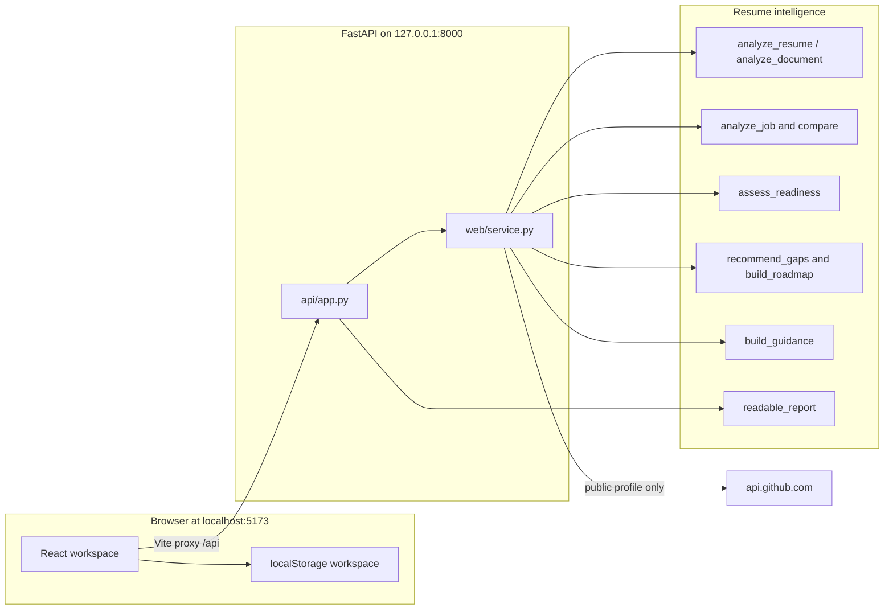

# Architecture

This is the system that is in the repository today.

## Request path

1. The React workspace sends a file or JSON to `/api/*`.
2. In development, Vite forwards `/api` to `http://127.0.0.1:8000`.
3. `api/app.py` validates the request and calls `web/service.py`.
4. The service checks the extension, the size, a content signature, and, when the browser sent one, the content type. It then writes an accepted upload to a temporary directory, calls the existing pipeline, and deletes the directory before returning. PNG and JPEG go to `analyze_document`. A PDF goes there only when OCR was requested. DOCX and TXT stay on `analyze_resume`.
5. Job comparison, readiness, recommendations, the roadmap, and guidance run on the objects already produced. They do not read the file again and they do not call an LLM. Guidance does not rescore.
6. `POST /api/report` calls the same career-report function and renders markdown from those objects. The readiness integer is copied. The guidance section is copied the same way.

Streamlit (`web/app.py`) still calls `web/service.py` directly. It does not go through FastAPI.

## What is not in this design

- PostgreSQL, Redis, email delivery, and hosted login providers are not used. Accounts are SQLite tables in the API. See [AUTHENTICATION.md](AUTHENTICATION.md).
- The browser keeps the theme locally. It does not keep the session token or another person's analysis.
- No embeddings, OpenAI, LangChain, or LangGraph.
- No job-board scraper.
- Tesseract, when OCR is requested, is a local executable. Its models are not trained here.

## Scoring

`assessment/readiness.py` scores required comparison outcomes with the weights in `config.py`: a matched required item contributes 1, and a related or missing required item contributes 0. The estimate is `round(100 * earned / scored)`. Preferred, unspecified, and unverified items are excluded from the denominator. If the denominator is 0, `estimate` is null. GitHub observations are listed and do not change the number.

`assessment/guidance.py` adds explanations after that score exists. A matched skill whose evidence is only a mention is labeled partial support and still earns credit. A related skill is labeled partial support and still earns none. Career-path labels require extracted skills in mapped taxonomy categories (at least two, and a named anchor category when the rule has one). Focus slots repeat roadmap order when a positive weekly hour budget was supplied. They are not a measured duration. The API logs method, path, status, byte size, and file suffix. It does not log file names, resume text, job text, usernames, or tokens.
